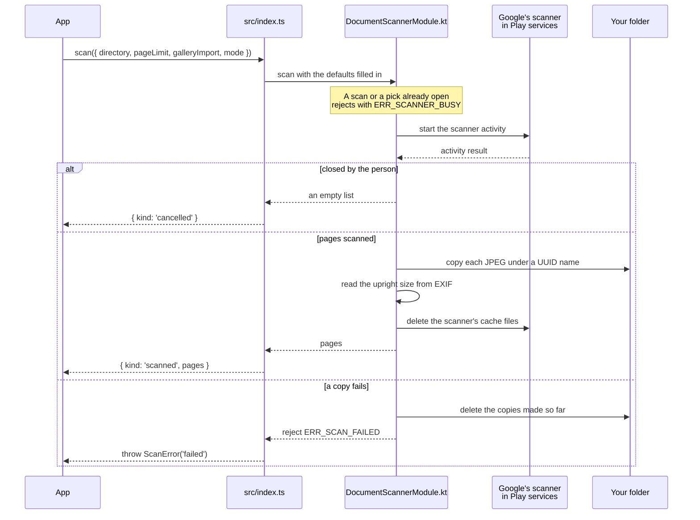
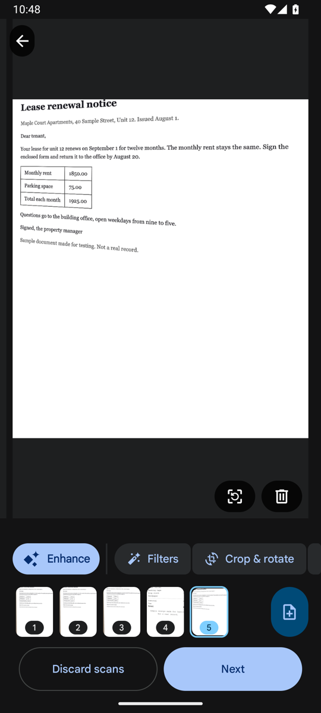
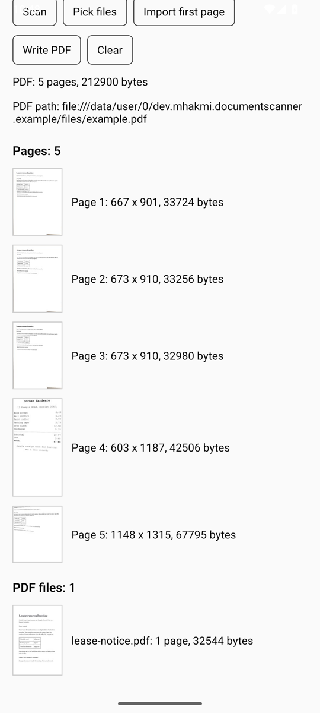

# expo-mlkit-document-scanner

An Expo module that opens Google's ML Kit document scanner on Android and writes PDFs from the pages it returns.

- `scan` opens the scanner with a page limit, a scanner mode, and gallery import on or off. It copies each page into a folder you name and returns the pages with their upright size.
- `prepare` downloads the scanner module ahead of the first scan and reports progress.
- `writePdf` builds a PDF from JPEG pages without decoding them, and holds at most one page in memory.
- `pickFiles` and `importFiles` bring in images and PDFs from other apps, with a PDF's page count and a thumbnail of its first page.
- Errors are typed. A closed scanner is a result, not an error.

The scanner runs inside Google Play services, so the app needs no camera permission and no manifest entry.

The package is Android only. On iOS and the web, `isAvailable()` resolves `false` and the other functions throw.

## Requirements

- Expo SDK 57 or 58, with React Native 0.86 or newer. The example app runs on SDK 58. A release build on SDK 57 (`expo` 57.0.31, `react-native` 0.86.3) loaded the module on an Android 15 emulator.
- `compileSdk` 36 or newer. The scanner library and `androidx.core` 1.17.0 need it.
- A phone with Google Play services. `isAvailable()` tells you whether the phone has it.

## Install

The package is not on npm yet. When it is, add it and rebuild the Android app:

```sh
npx expo install expo-mlkit-document-scanner
npx expo run:android
```

There is no config plugin. The R8 rule that ML Kit needs in a release build ships inside the library.

## Scan pages and write a PDF

```ts
import { prepare, scan, writePdf, ScanError, PdfError } from 'expo-mlkit-document-scanner';
import { Directory, File, Paths } from 'expo-file-system';

// Optional, at app start. Downloads the scanner module so the first scan does not wait.
prepare((fraction) => console.log(`scanner ${Math.round(fraction * 100)}%`)).catch(() => {});

const pages = new Directory(Paths.document, 'pages');
pages.create({ intermediates: true, idempotent: true });

const result = await scan({ directory: pages.uri, pageLimit: 20, galleryImport: true });
if (result.kind === 'cancelled') {
  return;
}
// result.pages is never empty. Each page is an upright JPEG in `pages`, named by a UUID.
const summary = await writePdf(result.pages, new File(Paths.document, 'out.pdf').uri);
console.log(summary.pageCount, summary.bytes);
```

A missing scanner, a second scan opened over the first, and a failed copy throw `ScanError`. Check its `kind` to tell them apart:

```ts
try {
  const result = await scan({ directory: pages.uri });
} catch (error) {
  if (error instanceof ScanError && error.kind === 'unavailable') {
    // Tell the person this phone cannot run Google's scanner.
  }
}
```

## How a scan moves



The folder never holds half a scan. If one page fails to copy, the module deletes the pages it already copied.

## API

### `isAvailable(): Promise<boolean>`

Resolves `true` when Google Play services is ready on the phone. Resolves `false` on any platform other than Android.

### `prepare(onProgress?: (fraction: number) => void): Promise<void>`

Downloads Google's scanner module, if the phone does not have it yet, and resolves when it is installed. `onProgress` gets a number from 0 to 1 while the download runs. Without `prepare`, the first `scan` downloads the module itself and the person waits.

Throws `ScanError('unavailable')` when the download fails or is cancelled.

### `scan(options: ScanOptions): Promise<ScanResult>`

Opens the scanner. When the person finishes, the module copies every page into `options.directory` and resolves with the pages.

| Option | Type | Default | Meaning |
|---|---|---|---|
| `directory` | `string` | required | A `file://` folder. The module creates it if it is missing. |
| `pageLimit` | `number` | `0` | The most pages the person can scan. `0` means no limit. |
| `galleryImport` | `boolean` | `false` | Lets the person add pictures from the gallery inside the scanner. |
| `mode` | `'full' \| 'base' \| 'filter'` | `'full'` | ML Kit's scanner mode. `base` has basic editing, such as crop and rotate. `filter` adds image filters. `full` adds ML Kit's cleaning tools. |

`ScanResult` is one of:

- `{ kind: 'scanned', pages: [ScannedImage, ...ScannedImage[]] }`. Each `ScannedImage` is `{ uri, width, height }`, where `width` and `height` already account for the EXIF orientation.
- `{ kind: 'cancelled' }`, when the person closes the scanner or it returns no pages.

Throws `ScanError` with kind `unavailable`, `busy`, or `failed`.

### `pickFiles(directory: string): Promise<ImportResult>`

Opens Android's file picker for PDFs and images, and copies each picked file into `directory`. Resolves with no files when the person closes the picker.

### `importFiles(uris: string[], directory: string): Promise<ImportResult>`

Copies files you already have URIs for, such as `content://` URIs from a share intent, into `directory`. It does the same work as `pickFiles` after the picker closes.

`ImportResult` is `{ files: ImportedFile[], skipped: number }`. `skipped` counts the inputs that were not an image or a PDF, or could not be read. Each `ImportedFile` is one of:

- `{ kind: 'image', uri, name, width, height }`, with the upright size.
- `{ kind: 'pdf', uri, name, pageCount, thumbnailUri }`, where `thumbnailUri` is a JPEG of the first page, 360 pixels wide.

Both functions throw `ScanError`. `pickFiles` throws kind `busy` when a scan or another pick is open.

### `writePdf(pages: [PdfPage, ...PdfPage[]], outputUri: string): Promise<PdfSummary>`

Writes a PDF with one page per image, in order, to the `file://` path `outputUri`. Each `PdfPage` is `{ uri, rotation? }`, where `rotation` is `0`, `90`, `180`, or `270` degrees clockwise on top of the image's EXIF orientation. Resolves with `{ pageCount, bytes }`.

Throws `PdfError` with one of these kinds:

| Kind | When |
|---|---|
| `page_missing` | A page's file does not exist. |
| `decode_failed` | A page's file is not an image Android can read. |
| `out_of_space` | The phone ran out of storage while writing. |
| `failed` | Anything else. |

When a write fails, the writer deletes its partial file. A file that was at `outputUri` before the call stays as it was.

### `ScanError` and `PdfError`

Both extend `Error` and carry a `kind` and a `message`.

| `ScanError` kind | When |
|---|---|
| `unavailable` | Google's scanner cannot run on this phone, or the platform is not Android. |
| `busy` | A scan or a file pick is already open. Only one runs at a time. |
| `failed` | Anything else. The message says what went wrong. |

## How the PDF writer works

`writePdf` puts each page's JPEG bytes into the PDF as the scanner made them, with no decoding. It turns a page with the PDF's own `/Rotate` entry instead of turning the pixels.

The writer decodes and re-encodes a page at JPEG quality 85 only when one of these is true:

- The page has more than 400 dots per inch on its paper size. The writer halves its width and height until it has 400 or fewer.
- The page is not a baseline or progressive 8-bit JPEG, for example a PNG.
- The page is a CMYK JPEG.

A page is A4 or Letter when the image has that shape, within 4 percent. Any other image, such as a receipt, gets the width of A4 and the height its shape needs.

The writer streams to `<outputUri>.part` and renames that file when it is done. It holds at most one page in memory.

### Measured size and memory

These numbers come from the Waraq app, where this code was first written. Waraq measured them on an Android emulator with ten 300 dpi A4 pages that have paper grain. The source is Waraq's README, in the table under "How a scan becomes a batch".

| Writer | PDF size | Native memory while writing |
|---|---|---|
| Android's `PdfDocument` | 99.9 MB | grew by 348 MB, and by 1089 MB for 30 pages |
| `writePdf` | 25.3 MB, the JPEGs plus about 500 bytes a page | no growth |

This repository measures the writer again with its instrumented tests. `dev/android.sh check` runs them on an Android 15 emulator (the `google_apis_playstore` arm64-v8a image with 3 GB of RAM) on an Apple silicon Mac. The tests draw three A4 pages at 300 dpi, 2480 by 3508 pixels with paper grain, and write PDFs of 10 and 30 pages from them. While the writer runs, a second thread reads the native heap every 5 milliseconds and keeps the highest value.

| Pages | PDF size | Native memory while writing |
|---|---|---|
| 10 | 25,340,259 bytes, from 25,335,177 bytes of JPEG | grew by less than 1 MB |
| 30 | 76,022,002 bytes | grew by less than 1 MB |

The 10-page PDF is 5,082 bytes larger than its JPEGs, about 500 bytes a page. PDFKit on the Mac opens it as 10 pages of 595 by 842 points, which is A4.

`dev/android.sh scan` writes a PDF from a real scan in the example app. The emulator's virtual camera scans the made-up lease notice in `dev/fixtures/` three times, and the scanner imports a receipt and the lease notice from the gallery. The virtual camera gives pages of about 700 by 900 pixels, much smaller than a phone camera gives. These sizes show what the writer adds to a page, not the size of a phone scan.

| Page | From | Pixels | JPEG size | PDF page, in points |
|---|---|---|---|---|
| 1 | camera | 667 x 901 | 33,724 bytes | 595 x 803, A4 width |
| 2 | camera | 673 x 910 | 33,256 bytes | 595 x 804, A4 width |
| 3 | camera | 673 x 910 | 32,980 bytes | 595 x 804, A4 width |
| 4 | gallery, the receipt | 603 x 1187 | 42,506 bytes | 595 x 1171, A4 width |
| 5 | gallery, the lease notice | 1148 x 1315 | 67,795 bytes | 595 x 681, A4 width |

The PDF is 212,900 bytes. That is its 210,261 bytes of JPEG plus 2,639 bytes, or 528 bytes a page. PDFKit opens it as 5 pages of the sizes in the table.

## Run the example app

`example/` is an Expo SDK 58 app with one screen that calls every function. It uses the package from this folder, not from npm.

`dev/android.sh` builds it and runs it on an emulator of its own. Put `JAVA_HOME` and `ANDROID_HOME` in `.dev-data/toolchain.env` or in the environment, then run:

```sh
dev/android.sh build     # build the package and the example's release APK for arm64-v8a
dev/android.sh unit      # run the Vitest tests and the Kotlin JVM tests
dev/android.sh boot      # boot the scanner_pixel emulator
dev/android.sh check     # run the instrumented tests on it and open their PDF with PDFKit
dev/android.sh install   # install the APK on it
dev/android.sh scan      # scan, import from the gallery, cancel, write a PDF, and pick a PDF in the example app
dev/android.sh stop      # stop the emulator and its adb server
```

`check` and `scan` need Xcode's command line tools on the Mac to run `dev/pdf-pages.swift`. `scan` also needs [grpcurl](https://github.com/fullstorydev/grpcurl) to turn the emulator's camera, in `GRPCURL` or on the `PATH`. The example's release build is debuggable, so `scan` can copy the PDF out of the app with `run-as`. R8 still shrinks it.

Run `dev/android.sh` with no command to see the rest.

<p>
  
  
</p>

On the left, Google's scanner holds three pages from the emulator's camera and two pictures from the gallery. On the right, the example app lists those five pages, the PDF it wrote from them, and a PDF picked with `pickFiles`.

## Why another scanner package

No other React Native scanner package downloads the scanner module ahead of time, and none writes a PDF from pages the app has changed. The ones that return a PDF hand back ML Kit's own, which cannot hold a turned page or a picture from another app. [Prior art for an ML Kit document scanner package](docs/prior-art.md) compares thirteen packages.

## License

MIT. See [LICENSE](LICENSE).
